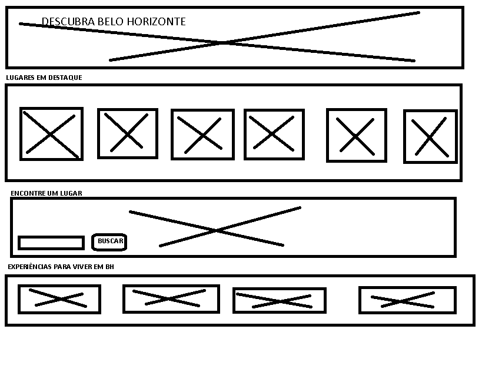
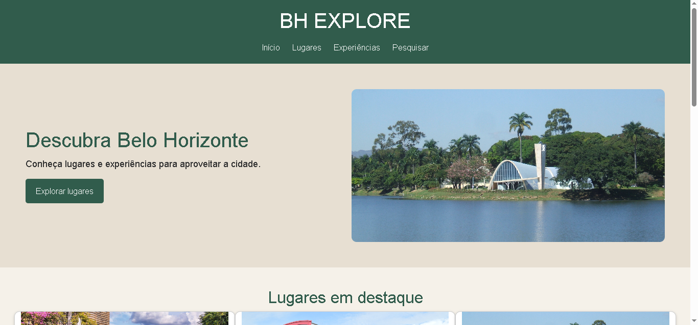
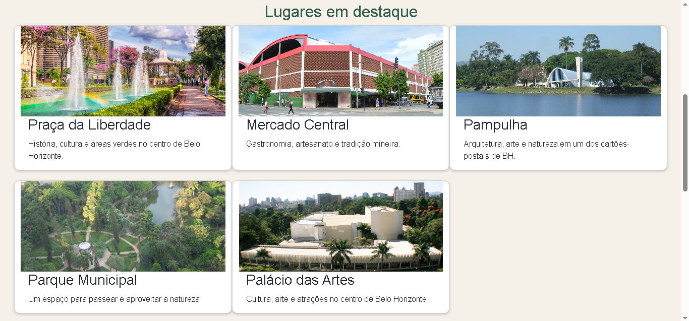
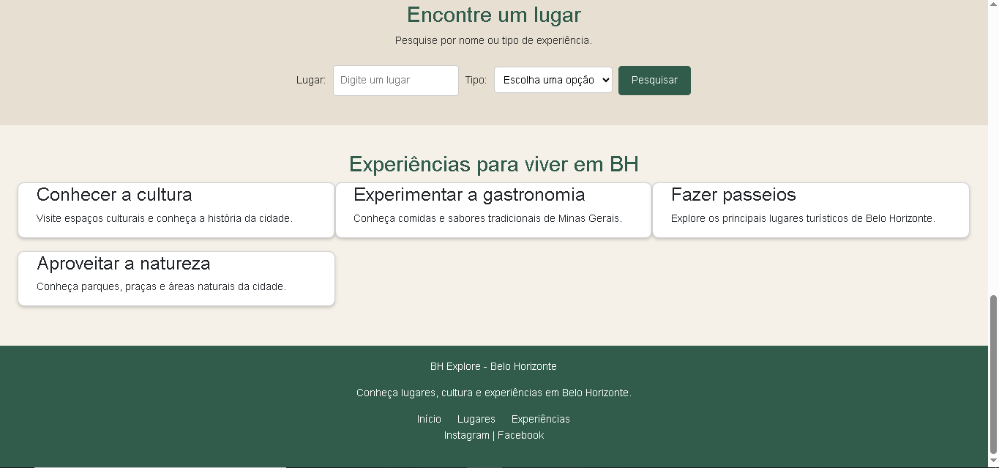
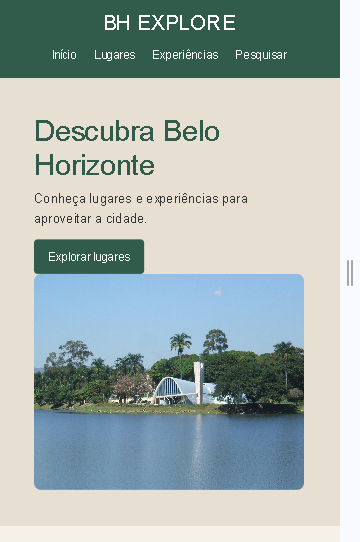
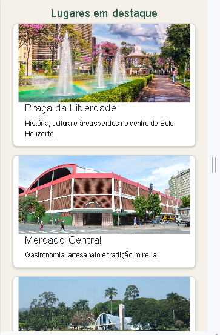
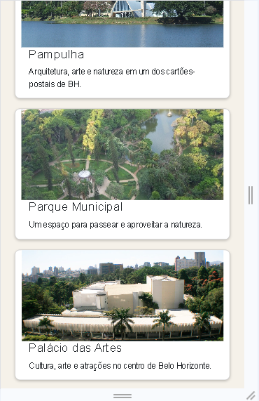
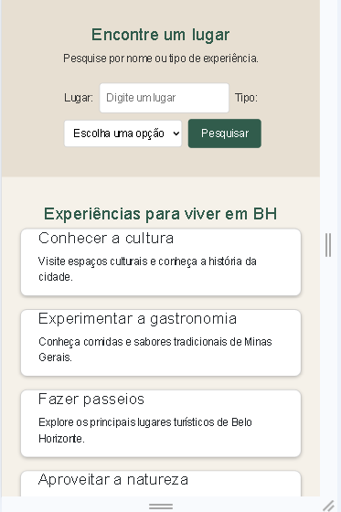
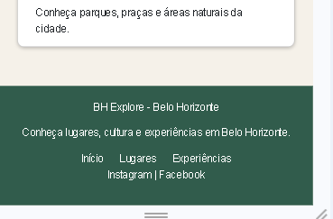

# BH Explore

## Dados do projeto

**Nome:** Ana Carolina Viana Ribeiro

**Matrícula:** 935888

**Proposta escolhida:** 2 - Lugares e Experiências

## Sobre o projeto

O BH Explore é um site criado para apresentar lugares e experiências em Belo Horizonte.

O objetivo é apresentar alguns dos principais lugares da cidade e experiências que podem ser realizadas nesses espaços.

## Wireframe

## Versão Desktop

## Versão Mobile

